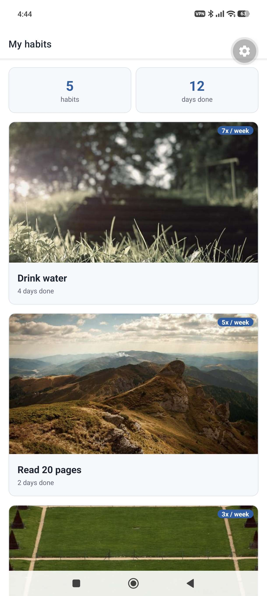
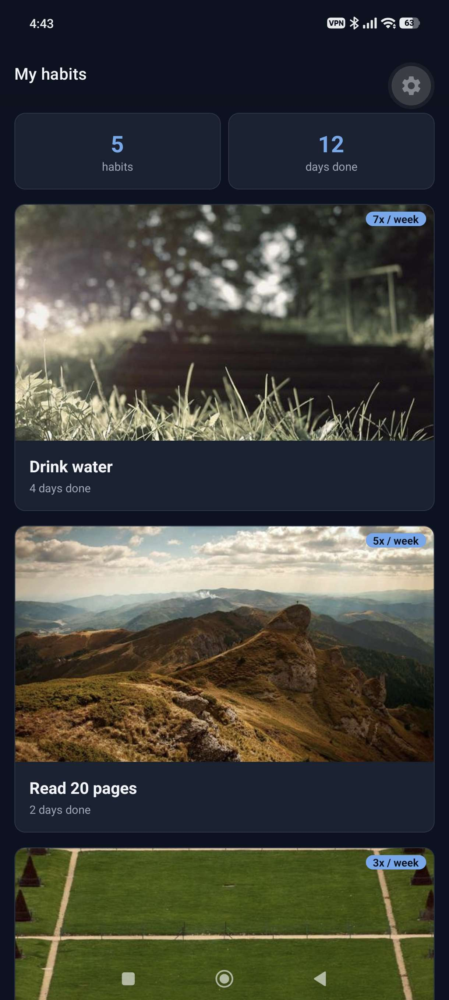

# Streak

Streak is a habit tracker. You add habits you want to keep up with (drink water, read, gym, no sugar) and check them off each day. It keeps a streak count for each habit and a short history, so you can see if you're actually keeping up.

## How to run

```
npm install
npx expo start
```

Then scan the QR code with the Expo Go app on your phone.

## Features

- [x] List of habits 
- [ ] Habit details screen with history and streak
- [ ] Add and edit habits
- [ ] Mark a habit done today
- [ ] Today tab and Habits tab, with a modal for adding a habit
- [ ] Haptic feedback when a habit is marked done
- [ ] Habits saved on the device
- [ ] Login, so each account sees only its own habits

## Screenshots



